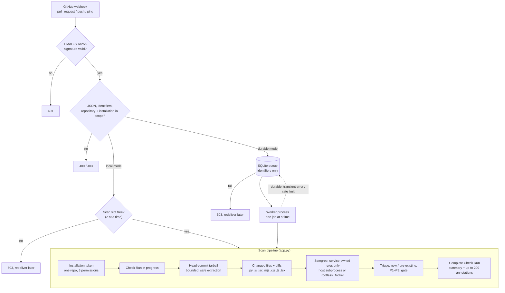

# Architecture

sast-triage is a GitHub App service. It receives pull request webhooks, scans the changed Python, JavaScript and TypeScript files of the exact head commit with service-owned Semgrep rules, labels each finding new or pre-existing from the pull request's diff, ranks it P1–P3, and reports the result as a Check Run that fails only on new P1 findings. `scan_repo.py` runs the same rules, triage and gate from the command line, on a whole repository or on what changed since a git ref, and `action.yml` wraps it as a GitHub Action. Deployment steps are in [deploy/README.md](deploy/README.md); trust boundaries and remaining risks are summarized in [SECURITY.md](SECURITY.md).

## Components

| File | Responsibility |
|---|---|
| `app.py` | FastAPI app: `/webhook`, `/health`, `/ready`. Body limit, HMAC check, payload and scope validation; local scans or durable enqueue. Also the GitHub client (App JWT, narrowed installation tokens, rate-limit detection, Check Run updates in batches of 50), the tarball download and extraction, and the scan pipeline. |
| `job_store.py` | Durable mode's SQLite queue: idempotent enqueue, claim, retry with backoff, global rate-limit cooldown, recovery, heartbeat and status. |
| `worker.py` | Durable mode's worker: drains the queue under an exclusive file lock, runs the pipeline and decides retry or failure. |
| `analyzers/semgrep_runner.py` | Stages only the requested files, runs Semgrep (or an explicitly selected Opengrep) on the host or in the Docker sandbox, rejects incomplete output, builds annotations and the summary. Accepts only one local, service-owned rule file. |
| `analyzers/triage.py` | Supported source files, diff parsing, new/pre-existing labels, test-code detection, P1–P3 and the gate. |
| `trusted_rules.py` | The 29 service-owned rules: 15 Python, 14 JavaScript and TypeScript. |
| `scan_repo.py` | Command-line scan: every supported file outside dependency, build and VCS folders (every finding new), or with `--base REF` only the files changed since that ref, labelled from a local `git diff` with the pull request rules. Exit status 1 when the gate fails, 0 when it passes, 2 on an error. |
| `action.yml` | GitHub Action: installs `requirements-cli.txt` with the runner's Python and runs `scan_repo.py` against the pull request's base branch. |
| `manage_jobs.py`, `queue_maintenance.py`, `job_payload.py` | Operator tools for the durable queue (status, explicit retry, backup and restore) and its payload validators. |
| `deploy/*.py` | Role configuration check, Linux acceptance runner, container boundary probe, scanner compatibility check, Opengrep signature check. |

## Execution modes

`PRSEC_MODE` selects how a validated delivery is processed.

| | `local` (default) | `durable` |
|---|---|---|
| Where scans run | FastAPI background task in the webhook process, at most 2 at a time | Separate `worker.py` process, one job at a time |
| Busy or full | 503 "Scanner busy" | 503 "Queue full" above 100 active jobs |
| Events | `pull_request` | `pull_request` and base-branch `push` (re-scans open PRs) |
| Scope variables | Checked when set | Required |
| Scanner | Host subprocess allowed | Rootless Docker sandbox required |
| Retries, stale-PR checks, restart recovery | No | Yes |
| Intended use | Development and a single trusted repository | Production, with separate web and worker OS users |

## Trust boundaries

- **Webhook sender.** Untrusted until the HMAC-SHA256 signature over the exact body matches a configured secret (constant-time comparison; comma-separated secrets allow rotation). Signed content is still validated before it builds any API path.
- **Pull request author.** Repository content is parsed, never executed or installed. Its Semgrep rules, ignore files, `.env`, Git metadata and `nosemgrep` comments never influence the scan.
- **Web listener.** In durable mode it holds only the webhook secret and queue access, runs as its own OS user and never calls GitHub.
- **Worker (durable) or webhook process (local).** The only component that reads the App private key, mints installation tokens, downloads repository data, launches the scanner and writes Checks.
- **Scanner.** An untrusted parser that receives only the staged files and the rule file. In durable mode it runs in the Docker sandbox below; in local mode it is a host subprocess with an allowlisted environment, which is **not** filesystem or network isolation.

## Failure handling

- **Fail closed.** Scanner errors, malformed output, unknown severities and files Semgrep did not report as scanned fail the check; only a complete scan can pass. A missing or unreadable diff makes every finding in that file new.
- **Deduplication (durable).** A job's id is the SHA-256 of its normalized payload, so redeliveries map to the existing job; a real reopen adds a hash of `X-GitHub-Delivery` and scans again.
- **Retries (durable).** Transient failures requeue the job with backoff `min(300 s, 5 s × 2^attempts)`; after 8 attempts it is marked failed. Permanent GitHub errors fail it without retry and complete the Check as failure.
- **Rate limits (durable).** HTTP 429, or 403 with `Retry-After` or `X-RateLimit-Remaining: 0`, pauses every claim for at least 60 s or the reset time, including after a restart.
- **Stale context (durable).** The worker re-reads the pull request during the scan; if it closed or its head or base changed, the Check is completed as `cancelled`.
- **Recovery (durable).** On start the worker returns interrupted jobs to the queue and fails those that used all attempts. Processing is at-least-once.
- **Limits.** 10,000 stored jobs; done jobs are pruned after 30 days. `/ready` returns 503 in durable mode until configuration is complete and a worker heartbeat is under five minutes old.

## Security controls

- Mandatory webhook signature, 1 MiB body limit, no API docs or OpenAPI schema, `.env` read only when `PRSEC_LOAD_DOTENV=1`.
- One repository and installation per deployment; installation tokens are narrowed to that repository with Contents read, Pull requests read and Checks write.
- Archives: 25 MiB compressed, 100 MiB extracted, 10,000 members, a single root directory, regular files and directories only, no absolute, `..` or duplicate paths, 60 s download deadline. Changed-file paths must stay inside the snapshot.
- Scanner: exactly one absolute, local rule file outside the scanned tree (no `auto`, registry IDs or URLs), metrics and version checks off, inline suppression disabled, one job, 1 MiB per file, bounded output and timeout.
- Docker sandbox: `--pull=never`, `--network=none`, `--read-only`, `--cap-drop=ALL`, `no-new-privileges`, UID/GID 65532, 1 CPU, 768 MiB memory and swap, 128 PIDs, read-only mounts for the staged files and rules; container removal is confirmed after every scan.
- Logs carry job ids, status codes and exception types, never tokens, payloads or response bodies.

## Out of scope

- Other languages, HTML templates, data flow across functions or files, secrets detection, dependency analysis (see [sca-triage](https://github.com/lansiquo/sca-triage)) and infrastructure code.
- More than one repository or installation per deployment, and more than one worker per queue.
- OS-level isolation in local mode, and executing or building repository code.
- A completed live deployment: the host, scanner image and live GitHub acceptance checks in [deploy/README.md](deploy/README.md) are still open.
